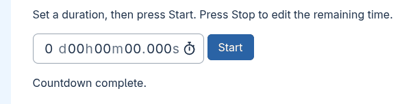

# Editable React-Countdown

An independent integration of [`@stephanluis/react-input-duration`](https://www.npmjs.com/package/@stephanluis/react-input-duration)
and [`react-countdown`](https://github.com/ndresx/react-countdown). The editable duration control
shows the remaining time while counting down. Applications provide their own controls.

[Try the live demo](https://stephanluis.github.io/react-countdown-editable/)



## Installation

```sh
npm install @stephanluis/react-countdown-editable
```

React 18.2 or 19 and React DOM are required.

## Usage

```jsx
import { useRef, useState } from 'react';
import EditableCountdown from '@stephanluis/react-countdown-editable';

function TimerExample() {
    const timer = useRef(null);
    const [running, setRunning] = useState(false);
    const [status, setStatus] = useState('Ready.');

    function start() {
        try {
            timer.current.start();
        } catch (error) {
            setStatus(error.message);
        }
    }

    return <>
        <EditableCountdown ref={timer} initialValue="0:00:00:10.000"
            onStart={() => { setRunning(true); setStatus('Countdown running.'); }}
            onStop={() => { setRunning(false); setStatus('Countdown stopped.'); }}
            onComplete={() => { setRunning(false); setStatus('Countdown complete.'); }} />
        <button type="button" onClick={running ? () => timer.current.stop() : start}>
            {running ? 'Stop' : 'Start'}
        </button>
        <p role="status">{status}</p>
    </>;
}
```

`initialValue` accepts `HH:mm:ss.SSS` or `D:HH:mm:ss.SSS`; it is used only on mount.
Call `start()` on the ref to use the last committed duration; it throws if the input is not ready,
invalid, zero, or outside JavaScript's safe integer and date ranges. Call `stop()` to preserve the
remaining duration for editing. Each method returns `true` when it acts and `false` if the timer is
already in that state. `onStart`, `onStop`, and `onComplete` are React callbacks; if `stop()` is
called after the deadline, `onComplete` is called instead of `onStop`.

The input is disabled while running and re-enabled on stop or completion. This project is not
affiliated with or endorsed by react-countdown.

## Local demo

Run `npm install`, then `npm run demo`, and open the URL printed by Vite. Run `npm test` to check
the integration and its TypeScript declarations.

After GitHub Pages is enabled with **GitHub Actions** as its source, the Pages workflow deploys
the demo to [GitHub Pages](https://stephanluis.github.io/react-countdown-editable/) on pushes to
`main`.
